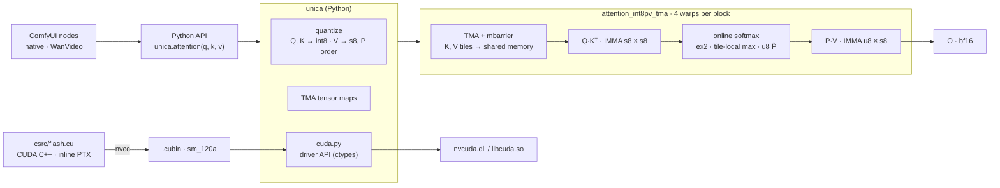

<p align="center">
  
</p>

<p align="center">
  <b>An attention kernel built for one GPU: the RTX 5080.</b><br>
  As fast as SageAttention 2 on WAN 2.2, with less than half its error.
</p>

<p align="center">
  
  
  
  
  
  
  
  <a href="https://github.com/k1n0F/vramsuite"></a>
</p>

---

*Unica*, Latin for "the only one of its kind". This is forward attention for video-diffusion inference, written for consumer Blackwell (sm_120) and nothing else. It is CUDA C++ with inline PTX `mma.sync` and TMA. nvcc builds it into a `.cubin`, and Python loads that through the CUDA driver API, so there is no C++ extension to rebuild for each PyTorch version.

## Results

WAN 2.2 14B attention shape, 1 × 40 heads × 32 760 tokens × 128 (81 frames at 832×480), bf16, RTX 5080. The whole call is timed, quantization included. Error is measured against FP32 on random inputs, the worst case for low precision.

| Kernel | Time | Speed-up | Error vs FP32 | cos |
|---|---|---|---|---|
| PyTorch SDPA | 528.0 ms | 1.0× | 0.23 % | 0.999997 |
| SageAttention 2 (INT8 QK · FP8 PV) | 76.4 ms | 6.9× | 3.90 % | 0.999238 |
| SageAttention 3 (FP4 block-scaled) | 58.1 ms | 9.1× | 19.11 % | 0.981755 |
| **UnicaAttention** (INT8 QK · u8×s8 PV) | **76.3 ms** | **6.9×** | **1.73 %** | **0.999850** |

All four kernels come from the same session of `bench/harness.py`. For SageAttention 2 and UnicaAttention the times are the mean of three runs (75.9 / 77.0 / 76.4 and 76.4 / 76.0 / 76.6 ms), which scatter by more than the difference between them. SDPA and SageAttention 3 come from a single run.

<p align="center">
  
</p>

Same session, from 1K to 32 760 tokens (`bench/speed_chart.py`). From 4K tokens up, UnicaAttention runs 0.7–5 % ahead of SageAttention 2. At 1–2K it is behind, because the fixed cost of quantizing Q, K and V still weighs on so short a call. SageAttention 3 is the fastest from 8K, at 19 % error.

**On real WAN 2.2 activations** (Q, K, V captured during an image-to-video run, 34 020 tokens, rel L2 vs FP32):

| Layer | UnicaAttention | SageAttention 2 | SageAttention 3 |
|---|---|---|---|
| block 19, four steps | **1.13 – 1.26 %** | 1.51 – 1.72 % | 10.1 – 11.2 % |
| block 39, four steps | 0.21 – 0.24 % | 0.20 – 0.24 % | 1.67 – 1.99 % |

Real attention is kinder than random inputs. Where a layer is hard, UnicaAttention is 1.3–1.45× more accurate than SageAttention 2. Where it is easy, both sit near the bf16 output floor.

**A real video.** The setup is WAN 2.2 image-to-video 14B (NVFP4, lightx2v 4 steps, 81 frames at 480×864) in ComfyUI, with the same image, prompt and seed. Only the self-attention kernel changes. The whole run is timed after a warm-up, with the variants alternating:

<p align="center">
  
</p>

| | SageAttention 2 | **UnicaAttention** | SageAttention 3 |
|---|---|---|---|
| whole video | 49.0 / 48.7 s | **49.5 / 48.9 / 48.8 s** | 45.7 / 45.2 s |

On a 4-step video, attention is only part of the run. UnicaAttention and SageAttention 2 take the same time, and SageAttention 3 saves ~3.5 s at 6–9× their error on these activations. The three videos part ways because their arithmetic differs, not because one of them is right: one seed is an anecdote, not a verdict.

**From the first correct kernel to now** (same shape, kernel or whole call as measured at the time):

| Step | Time | What changed |
|---|---|---|
| M1 | ~770 ms | plain flash attention on `mma.sync`, BF16 / FP16 |
| M2 | 214 ms | K / V tiles in shared memory, `ldmatrix` |
| M3.3 | 104 ms | INT8 Q·Kᵀ, then P·V as u8 × s8 |
| M3.4 | 90 ms | `cp.async` double-buffered tiles |
| M3.12–15 | 84 ms | Q·Kᵀ of the next tile issued under the softmax of this one |
| M3.17 | **76 ms** | tiles by TMA, V stored in the order the MMA reads it |

10× in all, at 1.73 % error.

## How it works

- **INT8 Q·Kᵀ** with one scale per 128 queries and per 64 keys. K is smoothed (its mean over tokens subtracted, which softmax cancels). The int32 result is exact, so dequantization is one factor folded into the softmax.
- **P·V as u8 × s8.** P is taken against the max of its own 64-key tile, so every tile uses all 256 steps of u8, and a factor corrects it when the tile is added in. V has one scale per channel. The denominator is summed over the rounded P̂ (`IDP4A`), the same P the MMA uses.
- **TMA** copies each tile. One thread issues it, an mbarrier says when it has landed. The TMA box is 16 bytes wider than a row: the bytes outside the tensor arrive as zeros, so tiles land padded and `ldmatrix` reads them without bank conflicts. V8 is stored in the order the P fragments need, with the keys k and k + 16 interleaved, so `ldmatrix` returns the MMA operands ready to use.
- **The Q·Kᵀ of tile t + 1 is issued before the softmax of tile t**, so the tensor cores have work while the exponents run.
- **Measured, not assumed.** Every step starts with a written prediction, and the result is recorded even when the prediction failed. Many did. One finding: under full load the RTX 5080 sits at its 360 W power limit, so saving cycles only helps if it also saves energy. The whole log: [LOG.md](LOG.md).
- **The machine is measured with [VRAM Suite](https://github.com/k1n0F/vramsuite)**, the sibling project. `vramsuite transfer` gives the bandwidth the quantization passes are held against: VRAM ~808 GB/s, PCIe Gen5 x8 ~28.6 GB/s pinned. `vramsuite doctor` gives the driver's view of free VRAM, which decides whether a benchmark run counts at all. With ComfyUI still holding 6.9 GB, SageAttention 3 looked 46 % slower than with that memory freed.

## Architecture



```text
csrc/flash.cu        every kernel, from the plain M1 one to attention_int8pv_tma, and the quantizers
csrc/peak.cu         peak rates of the instructions attention is built from
unica/__init__.py    attention(), kernel_inputs(), quantization, tensor maps
unica/cuda.py        nvcc → .cubin, driver API loader, kernel launch, cuTensorMapEncodeTiled
comfyui/             the two ComfyUI nodes
bench/               harness, emulator of every quantization step, compare, profiling, charts
tests/               against FP32, the emulator and each other, bit for bit where they should be
```

## Use

From source. You need an RTX 5080 (sm_120), the CUDA Toolkit 13.x (nvcc) and, on Windows, MSVC for nvcc's host compiler. The first call builds the `.cubin`.

```bash
git clone https://github.com/k1n0F/UnicaAttention
cd UnicaAttention
uv sync
uv run python tests/test_attention.py
```

```python
import unica

out = unica.attention(q, k, v)  # [batch, heads, tokens, 128] bf16, like SDPA's default layout
```

**ComfyUI.** Link the `comfyui` folder into `ComfyUI/custom_nodes` (a directory junction on Windows) after the `.cubin` has been built once:

- **Unica Attention (native)**: for ComfyUI's own WAN models. Put it after `PathchSageAttentionKJ`. Self-attention goes to UnicaAttention, everything else, including cross-attention to the text, stays on SageAttention.
- **Unica Attention (WanVideo)**: for ComfyUI-WanVideoWrapper, between the model loader and the sampler.

Both can log UnicaAttention, SageAttention 2 and SageAttention 3 against FP32 on the real Q, K, V of a run (`measure_every`).

## Roadmap

| | Milestone | |
|---|---|---|
| M0 | Build, loader and a harness that reproduces the baseline | done |
| M1 | Plain, correct flash attention on `mma.sync` | done |
| M2 | Shared memory, `ldmatrix`, tile sizes for sm_120 | done |
| M3 | INT8 / u8 × s8 path, TMA, compared with SageAttention 2 | done |
| M4 | FP4 block-scaled path, compared with SageAttention 3 | planned |
| M5 | ComfyUI integration, real WAN 2.2 video | in progress |

Every result goes to [rigsy.dev/bench](https://rigsy.dev/bench), wins and losses alike. The baselines there (SDPA 511 ms, SageAttention 2 76 ms at 3.9 %, SageAttention 3 56 ms at 19 %) were measured on the same machine on 29 October 2026.

## License

[MIT](LICENSE).
