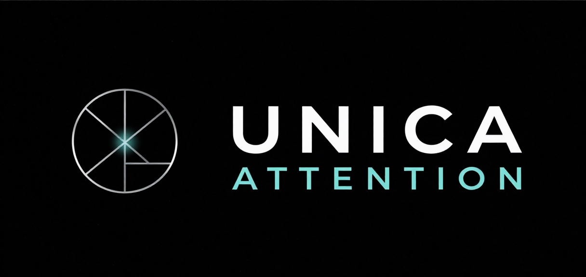
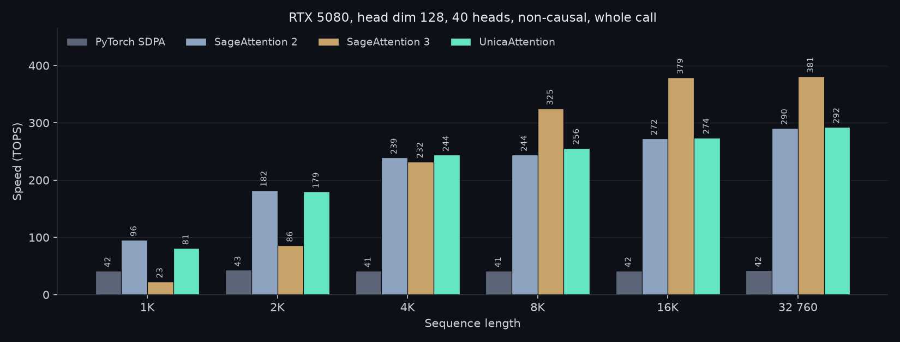
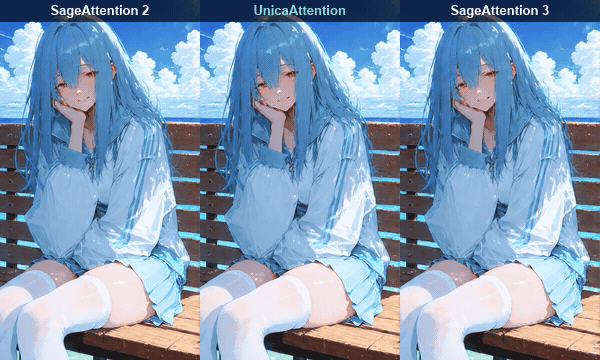
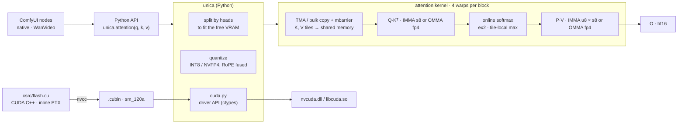

<p align="center">
  
</p>

<p align="center">
  <b>An attention kernel built for one GPU: the RTX 5080.</b><br>
  Two modes for video diffusion: <i>accurate</i>, with 1.3–2× less error than SageAttention 2,
  and <i>fast</i>, below SageAttention 3's error and the fastest mode on WAN 2.2.
</p>

<p align="center">
  
  
  
  
  
  
  
  <a href="https://github.com/k1n0F/vramsuite"></a>
</p>

---

*Unica*, Latin for "the only one of its kind". This is forward attention for video-diffusion inference, written for consumer Blackwell (sm_120) and nothing else. It is CUDA C++ with inline PTX `mma.sync` and TMA. nvcc builds it into `.cubin` files, and Python loads them through the CUDA driver API, so there is no C++ extension to rebuild for each PyTorch version.

| Mode | Arithmetic | Rival | Error against the rival | Speed against the rival |
|---|---|---|---|---|
| **accurate** | INT8 Q·Kᵀ · u8 × s8 P·V | SageAttention 2 | below it in 135 of 136 real calls | level at 118 K tokens, 4–8 % slower on a 4-step WAN render |
| **fast** | NVFP4 Q·Kᵀ and P·V, Q smoothed | SageAttention 3 | below it in 131 of 136 real calls | faster on long calls, slower on short ones; runs where SageAttention 3 runs out of VRAM |

The kernel is not tied to WAN. It runs any self-attention with 128-dimensional heads, and the native ComfyUI node routes it for every model that uses ComfyUI's attention: video (WAN 2.2, LTX-2.3) and image (Qwen-Image-Edit, Z-Image, Moss) are measured below. WAN 2.2 is the main test because it is the heaviest one: 34 K tokens per call for a short clip and 118 K for a hires pass, where attention takes most of the time and a kernel's speed and error show the most.

## Results

Everything is measured on one RTX 5080. Every step started with a written prediction, and the result is recorded even when the prediction failed: [LOG.md](https://github.com/k1n0F/UnicaAttention/blob/main/LOG.md).

### Five models in ComfyUI, real activations

Error of self-attention against FP32 on the Q, K, V of real renders (median rel L2, and in how many measured calls it is below the rival). The graphs, seeds and models are in [bench/comfyui/](https://github.com/k1n0F/UnicaAttention/tree/main/bench/comfyui), so the run can be repeated (`bench/comfyui_models.py`).

| Model | SageAttention 2 | **accurate** | SageAttention 3 | **fast** |
|---|---|---|---|---|
| WAN 2.2 14B, image to video | 1.51 % | **0.78 %**, 21 / 22 | 8.60 % | **8.16 %**, 22 / 22 |
| LTX-2.3 | 0.58 % | **0.42 %**, 20 / 20 | 3.44 % | **3.10 %**, 17 / 20 |
| Qwen-Image-Edit | 1.81 % | **1.14 %**, 20 / 20 | 12.37 % | **10.94 %**, 20 / 20 |
| Z-Image | 2.07 % | **1.05 %**, 34 / 34 | 15.29 % | **12.13 %**, 32 / 34 |
| Moss | 2.08 % | **1.10 %**, 40 / 40 | 13.18 % | **11.73 %**, 40 / 40 |

A whole WAN 2.2 render (81 frames, 4 steps, 34 020 tokens; median of three rounds):

| | SageAttention 2 | SageAttention 3 | accurate, V per channel | accurate, V per token | **fast** |
|---|---|---|---|---|---|
| render | 45.9 s | 46.6 s | 47.9 s | 49.4 s | **44.6 s** |

On error, UnicaAttention wins on every model. On time, fast is the fastest mode on WAN, and the accurate modes are 4–8 % behind SageAttention 2 there. On the image models, whose calls are short and where attention is not what takes the time, all kernels are within a few tenths of a second, and fast is the slower of the two 4-bit kernels.

### A long video: 118 320 tokens

The hires pass of a three-pass WAN 2.2 workflow: 113 frames at 768 × 1360, one call is 118 320 tokens. The call does not fit next to the 14B model in 16 GB, so UnicaAttention splits it by heads to stay in the VRAM the driver reports free; under WDDM, running past it moves memory to system RAM and slows a render many times over.

| | SageAttention 2 | **accurate** | **fast** | SageAttention 3 |
|---|---|---|---|---|
| hires pass, 4 steps | 263 s | **259 s** | **197 s** | does not fit: one call needs 27.9 GiB |
| error on its real Q, K, V | 1.23 % | **0.83 %** | **7.46 %** | 8.04 % (on the same Q, K, V, outside the render) |

### The kernel alone

WAN 2.2 attention shape, 1 × 40 heads × 32 760 tokens × 128, bf16, random inputs (the worst case for low precision). The whole call is timed, quantization included; all four from one session of `bench/harness.py`.

| Kernel | Time | Speed-up | Error vs FP32 | cos |
|---|---|---|---|---|
| PyTorch SDPA | 528.0 ms | 1.0× | 0.23 % | 0.999997 |
| SageAttention 2 (INT8 QK · FP8 PV) | 76.4 ms | 6.9× | 3.90 % | 0.999238 |
| SageAttention 3 (FP4 block-scaled) | 58.1 ms | 9.1× | 19.11 % | 0.981755 |
| **UnicaAttention accurate**, V per channel | **76.3 ms** | **6.9×** | **1.73 %** | **0.999850** |

The fast mode on WAN's real shape (34 020 tokens), in its own session: 57.3 ms against SageAttention 3's 62.7 ms for the whole call.

<p align="center">
  
</p>

From 1K to 32 760 tokens (`bench/speed_chart.py`, accurate mode). From 4K tokens up, UnicaAttention runs 0.7–5 % ahead of SageAttention 2. At 1–2K it is behind: the fixed cost of quantizing Q, K and V weighs on so short a call.

**A real video.** WAN 2.2 image-to-video 14B (NVFP4, lightx2v 4 steps, 81 frames at 480×864) in ComfyUI, with the same image, prompt and seed; only the self-attention kernel changes:

<p align="center">
  
</p>

The three videos part ways because their arithmetic differs, not because one of them is right: one seed is an anecdote, not a verdict.

**From the first correct kernel to now:**

| Step | Time | What changed |
|---|---|---|
| M1 | ~770 ms | plain flash attention on `mma.sync`, BF16 / FP16 |
| M2 | 214 ms | K / V tiles in shared memory, `ldmatrix` |
| M3.3 | 104 ms | INT8 Q·Kᵀ, then P·V as u8 × s8 |
| M3.4 | 90 ms | `cp.async` double-buffered tiles |
| M3.12–15 | 84 ms | Q·Kᵀ of the next tile issued under the softmax of this one |
| M3.17 | **76 ms** | tiles by TMA, V stored in the order the MMA reads it: accurate mode, 10× M1 |
| M4.8–15 | 46.5 ms at 34 020 tokens | NVFP4 Q·Kᵀ and P·V, each tile one bulk copy: SageAttention 3's error class |
| M4.21 | 57.3 ms at 34 020 tokens | Q smoothed per 512 queries: fast mode, below SageAttention 3's error |
| M4.23 | | V with one scale per token: Z-Image 9.1 % → 1.1 % |
| M4.31–32 | | calls split by heads to stay in the VRAM: 118 320 tokens on 16 GB |

## How it works

- **INT8 Q·Kᵀ** with one scale per 128 queries and per 64 keys. K is smoothed (its mean over tokens subtracted, which softmax cancels). The int32 result is exact, so dequantization is one factor folded into the softmax.
- **P·V as u8 × s8.** P is taken against the max of its own 64-key tile, so every tile uses all 256 steps of u8, and a factor corrects it when the tile is added in. The denominator is summed over the rounded P̂ (`IDP4A`), the same P the MMA uses.
- **V with one scale per token** (the default). Some models have a few V tokens 65–250× larger than the rest (Z-Image: two of them), and one scale per channel then crushes everything else. A per-token scale cannot stay outside a sum over tokens, so it goes into P instead: log₂ of the scale is added to the score before the exponent, and the denominator is corrected by it.
- **The fast mode** runs both products in NVFP4 (4-bit values, one FP8 scale per 16), twice the INT8 rate. Q is smoothed per 512 queries: their mean is subtracted before quantizing, and its product with K, computed in higher precision, is added back as the starting value of the Q·Kᵀ accumulator.
- **TMA and bulk copies** load each tile; one thread issues the copy, an mbarrier says when it has landed. In the accurate mode the TMA box is 16 bytes wider than a row, so tiles land padded and `ldmatrix` reads them without bank conflicts.
- **The Q·Kᵀ of tile t + 1 is issued before the softmax of tile t**, so the tensor cores have work while the exponents run.
- **In ComfyUI**, the nodes read WAN's own layout without copies, can apply RoPE inside the quantization (`fuse_rope`), and split a call by heads when the driver's free VRAM is short.
- **The machine is measured with [VRAM Suite](https://github.com/k1n0F/vramsuite)**, the sibling project: bandwidth (VRAM ~808 GB/s, PCIe Gen5 x8 ~28.6 GB/s pinned) and the driver's view of free VRAM, which decides whether a benchmark run counts at all. Under full load the RTX 5080 sits at its 360 W power limit, so saving cycles only helps if it also saves energy.

## Architecture



```text
csrc/flash.cu        every kernel, from the plain M1 one to the fast mode, and the quantizers
csrc/peak.cu         peak rates of the instructions attention is built from
unica/               attention(), presets, quantization, tensor maps, compatibility check, driver API loader
comfyui/             the ComfyUI nodes
bench/               harness, emulator of every quantization step, ComfyUI benches, profiling, charts
tests/               against FP32, the emulator and each other, bit for bit where they should be
```

## Use

You need an RTX 5080 or another sm_120 card, a driver for CUDA 13, and PyTorch with CUDA. The package ships the compiled kernels, so nvcc is not needed to run them; it works on Windows and on Linux (checked in WSL2 on the same card). The current release is a beta, so pip needs `--pre`.

```bash
pip install torch --index-url https://download.pytorch.org/whl/cu132   # first, or pip brings a CPU-only torch
pip install --pre unica-attention
python -m unica                       # is this machine supported? then each mode against FP32
```

From source (needs nvcc, and MSVC on Windows): `uv run python build_wheel.py` compiles the kernels and builds the wheel into `dist/`.

```python
import unica

out = unica.attention(q, k, v)  # [batch, heads, tokens, 128] bf16, like SDPA's default layout
```

`unica.compatibility()` says *ok*, *untested* (another sm_120 card, an older driver, another torch) or *cannot run*, and why.

**ComfyUI.** Link the `comfyui` folder into `ComfyUI/custom_nodes` (a directory junction on Windows):

- **Unica Attention (native)**: for ComfyUI's own models (WAN, LTX, Qwen, Z-Image, Moss). Put it after `PathchSageAttentionKJ`: self-attention goes to UnicaAttention, everything else, including cross-attention to the text, stays where it was.
- **Unica Attention (WanVideo)**: for ComfyUI-WanVideoWrapper, between the model loader and the sampler.
- **RIFE VFI (Unica)**: a drop-in for comfyui-frame-interpolation's RIFE node, with its models and the same frames (PSNR 98 dB), and a rebuilt loop: each frame uploaded once, a pair's middle frames in one batch, no `gc.collect()` per pair. In a WAN render's ×5 interpolation of 113 frames at 1536 × 2720: 138 s → 41 s.

Inputs: `mode` (accurate or fast), `v_scale` (per token, per channel, or outliers), `vram_reserve_mb`, and on the native node `fuse_rope`. Both nodes can log UnicaAttention, SageAttention 2 and 3 against FP32 on the real Q, K, V of a run (`measure_every`). If the card cannot run the kernels, the nodes leave the model's own attention in place.

## Roadmap

| | Milestone | |
|---|---|---|
| M0 | Build, loader and a harness that reproduces the baseline | done |
| M1 | Plain, correct flash attention on `mma.sync` | done |
| M2 | Shared memory, `ldmatrix`, tile sizes for sm_120 | done |
| M3 | INT8 / u8 × s8 path, TMA, compared with SageAttention 2 | done |
| M4 | FP4 block-scaled path, compared with SageAttention 3 | goal reached, not closed |
| M5 | ComfyUI integration, real video, the workflow around attention | in progress |

M4's goal is reached: the fast mode is below SageAttention 3's error on every model and faster on long calls. The milestone stays open while both modes are actively polished and developed: the accurate mode's speed against SageAttention 2 on short renders, the fast mode on short calls, and the workflow around attention. Next for the nodes: their own repositories of ComfyUI custom nodes, installable from ComfyUI Manager.

Every result goes to [rigsy.dev/bench](https://rigsy.dev/bench), wins and losses alike.

## License

[MIT](https://github.com/k1n0F/UnicaAttention/blob/main/LICENSE).
